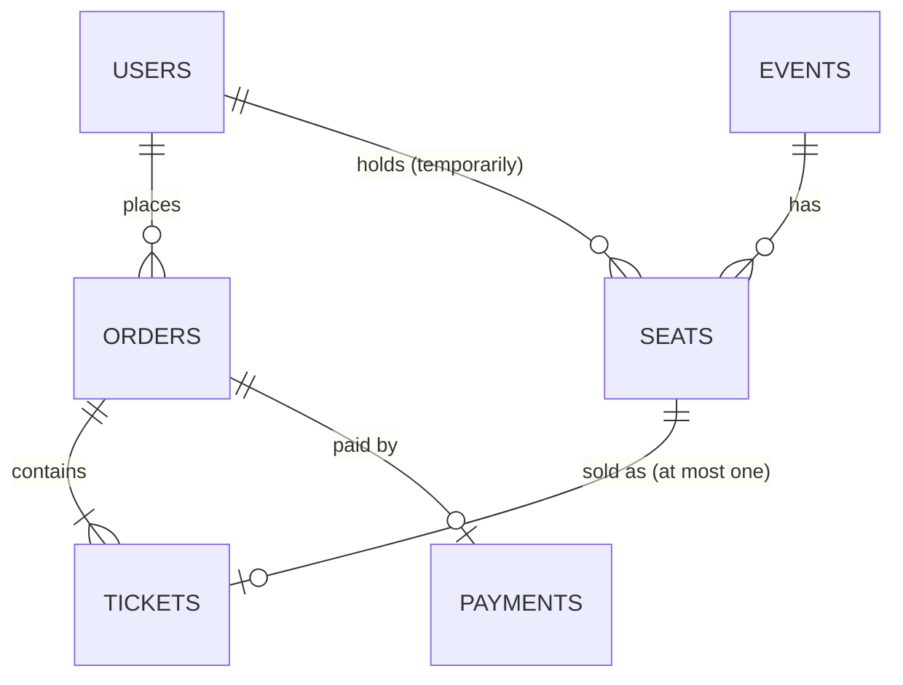
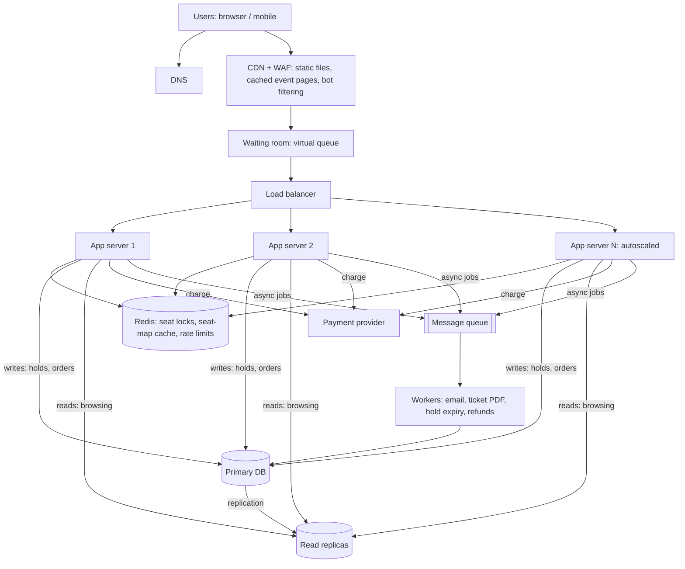

# TicketHub: System Design

TicketHub is a website that sells tickets for concerts and events. It has 2 million registered users. Most days it is quiet; a few times a year a very popular concert goes on sale and traffic explodes. The design must handle both, and it must never sell the same seat twice.

---

## 1. Requirements

### Functional
- Users can register, log in and manage their profile.
- Users can browse and search events (by name, city, date, category).
- Users can open an event and see its seat map with live availability.
- Users can **hold** up to 6 seats for 5 minutes while they check out.
- Users can pay for held seats and receive confirmed tickets (on screen and by email).
- Users can view their tickets ("My tickets") and release a hold they no longer want.
- Admins can create events and set seat prices (out of scope for this document's detail).

### Non-functional

| Quality | Requirement |
|---------|-------------|
| **Speed** | Normal days: event pages p95 < 300 ms. Big sale: seat map < 1 s, hold response < 500 ms, checkout < 3 s (including the payment provider). |
| **Correctness** | A seat is never sold to two people. A user is never charged without receiving a ticket, and never given a ticket without payment. Payments are idempotent (a retry never double-charges). |
| **Fairness** | First come, first served: people who arrive earlier get earlier access. Per-user limit of 6 tickets per event. Bots and scripts are throttled so humans are not crowded out. |
| **Availability** | 99.9% normally; 99.99% during a big sale window. Browsing must keep working even if payments are slow. |
| **Scalability** | Handle roughly 600 times normal load for short bursts, with no change to the code (autoscaling plus a waiting room). |
| **Durability** | A confirmed order is never lost (replicated database, backups). |
| **Security** | HTTPS everywhere, hashed passwords, card data handled only by the payment provider (never stored by us). |

---

## 2. Estimates

### Given facts
2 million registered users; 50,000 visitors on a normal day, each viewing 10 pages; 5,000 tickets sold on a normal day; a big sale has 200,000 people trying to buy 20,000 seats in the first 10 minutes.

### Normal day
- Page views: 50,000 × 10 = **500,000 per day** → 500,000 / 86,400 ≈ **6 requests/second** on average. Assuming the busiest hour carries 10% of the day: 50,000 / 3,600 ≈ **14 requests/second**.
- Ticket sales: 5,000 per day → ≈ **0.06 sales/second** on average (about 0.5/second in the busiest hour).
- Storage: 5,000 tickets/day × 365 ≈ 1.8 million tickets per year at about 1 KB each ≈ **2 GB/year** (plus about 20 million seat rows per year for ~1,000 events of 20,000 seats, about 4 GB). Storage is small; **concurrency is the real problem**.

### Big sale (10-minute window = 600 seconds)
- Arrivals: 200,000 / 600 ≈ **333 new users/second**.
- Requests: assume each user makes about 10 requests (event page, several seat-map refreshes, hold attempts, checkout). 200,000 × 10 = 2 million requests / 600 s ≈ **3,300 requests/second on average**. Traffic is front-loaded in the first minute, so assume a peak of about 3× → **~10,000 requests/second**.
- Hold attempts: assume 3 attempts per user (many seats are already gone) → 600,000 / 600 ≈ **1,000 hold attempts/second**, peaking at about **3,000/second**.
- Sales: at most 20,000 seats / 600 s ≈ **33 successful sales/second**, with payment peaks around **100/second**.
- Contention: 200,000 people for 20,000 seats = **10 people per seat**, so 90% of buyers will lose. The system must say "no" quickly and kindly.

### Comparison

| Metric | Normal day | Big sale | Ratio |
|--------|-----------|----------|-------|
| Page requests/second (avg) | ~6 | ~3,300 | **~550×** |
| Page requests/second (peak) | ~14 | ~10,000 | **~700×** |
| Sales/second (avg) | ~0.06 | ~33 | **~550×** |
| Tickets sold | 5,000 per **day** | 20,000 in **10 minutes** | 4× a full day's sales in 1/144 of the time |

**Conclusion:** a design sized for a normal day would collapse under a big sale, and a design sized for the big sale would waste money 360 days a year. We need elasticity (autoscaling), caching, and a way to **shape** the traffic (a waiting room) rather than just absorbing it.

---

## 3. API

Base path `/v1`. JSON. Auth by bearer token (except public browsing).

| # | Method | Path | Purpose | Success |
|---|--------|------|---------|---------|
| 1 | GET | `/events?city=&date=&q=&cursor=` | Browse and search events | 200 |
| 2 | GET | `/events/{eventId}` | Event details (cacheable) | 200 |
| 3 | GET | `/events/{eventId}/seats?section=` | Seat map with availability | 200 |
| 4 | POST | `/events/{eventId}/holds` | Hold seats for 5 minutes | 201 |
| 5 | DELETE | `/holds/{holdId}` | Release a hold | 204 |
| 6 | POST | `/orders` | Pay for a hold and create the order | 201 |
| 7 | GET | `/me/tickets` | View my tickets | 200 |
| 8 | GET | `/orders/{orderId}` | Order status | 200 |

### Hold seats
`POST /events/77/holds`
```json
{ "seatIds": [1203, 1204] }
```
`201 Created`
```json
{
  "holdId": "h_8f31",
  "eventId": 77,
  "seatIds": [1203, 1204],
  "expiresAt": "2026-11-20T18:05:00Z"
}
```
If any seat is already taken, nothing is held (all or nothing):
`409 Conflict`
```json
{ "error": { "code": "SEAT_UNAVAILABLE", "message": "Seat 1204 was just taken.", "unavailableSeatIds": [1204] } }
```

### Pay
`POST /orders` with header `Idempotency-Key: 5b1c...` (the same key on a retry returns the same order and never charges twice)
```json
{ "holdId": "h_8f31", "paymentToken": "tok_abc123" }
```
`201 Created`
```json
{ "orderId": 9001, "status": "PAID", "total": 240.00, "tickets": [{ "ticketId": 55001, "seatId": 1203 }, { "ticketId": 55002, "seatId": 1204 }] }
```

### Errors

| Status | When |
|--------|------|
| 400 | Invalid input (more than 6 seats, empty list) |
| 401 | Not logged in |
| 402 | Payment declined |
| 403 | Releasing or paying for someone else's hold |
| 404 | Unknown event, hold or order |
| 409 | Seat already taken |
| 410 | Hold expired |
| 429 | Too many requests (rate limit) |
| 503 + `Retry-After` | System at capacity; user is sent to the waiting room |

---

## 4. Data Model



```sql
CREATE TABLE users (
  id            BIGINT PRIMARY KEY,
  email         VARCHAR(255) NOT NULL UNIQUE,
  password_hash VARCHAR(255) NOT NULL,
  created_at    TIMESTAMP NOT NULL DEFAULT now()
);

CREATE TABLE events (
  id         BIGINT PRIMARY KEY,
  name       VARCHAR(200) NOT NULL,
  venue      VARCHAR(200) NOT NULL,
  city       VARCHAR(100) NOT NULL,
  starts_at  TIMESTAMP NOT NULL,
  sale_opens TIMESTAMP NOT NULL
);

CREATE TABLE seats (
  id              BIGINT PRIMARY KEY,
  event_id        BIGINT NOT NULL REFERENCES events(id),
  section         VARCHAR(20) NOT NULL,
  row_label       VARCHAR(10) NOT NULL,
  seat_number     INT NOT NULL,
  price           NUMERIC(10,2) NOT NULL,
  status          VARCHAR(10) NOT NULL DEFAULT 'AVAILABLE'
                  CHECK (status IN ('AVAILABLE','HELD','SOLD')),
  held_by         BIGINT REFERENCES users(id),
  hold_id         VARCHAR(40),
  hold_expires_at TIMESTAMP,
  UNIQUE (event_id, section, row_label, seat_number)   -- the same physical seat cannot exist twice
);

CREATE TABLE orders (
  id               BIGINT PRIMARY KEY,
  user_id          BIGINT NOT NULL REFERENCES users(id),
  event_id         BIGINT NOT NULL REFERENCES events(id),
  total            NUMERIC(10,2) NOT NULL,
  status           VARCHAR(10) NOT NULL CHECK (status IN ('PENDING','PAID','FAILED')),
  idempotency_key  VARCHAR(64) NOT NULL UNIQUE,         -- a retry cannot create a second order
  created_at       TIMESTAMP NOT NULL DEFAULT now()
);

CREATE TABLE tickets (
  id       BIGINT PRIMARY KEY,
  order_id BIGINT NOT NULL REFERENCES orders(id),
  seat_id  BIGINT NOT NULL UNIQUE REFERENCES seats(id)  -- THE safety net: one ticket per seat, ever
);

CREATE TABLE payments (
  id           BIGINT PRIMARY KEY,
  order_id     BIGINT NOT NULL UNIQUE REFERENCES orders(id),
  provider_ref VARCHAR(100) NOT NULL,
  amount       NUMERIC(10,2) NOT NULL,
  status       VARCHAR(10) NOT NULL
);

CREATE INDEX idx_seats_event_status ON seats (event_id, status);
CREATE INDEX idx_seats_hold_expiry  ON seats (hold_expires_at) WHERE status = 'HELD';
CREATE INDEX idx_orders_user        ON orders (user_id, created_at DESC);
```

**Relationships**
- One user has many orders (one-to-many); one event has many seats (one-to-many).
- One order contains one or more tickets (one-to-many); each ticket points to exactly one seat.
- A seat is sold at most once: `tickets.seat_id` is UNIQUE, which makes seat to ticket one-to-zero-or-one.
- One order has one payment.

**Why SQL:** seats, orders and payments must change together or not at all, and the database must enforce rules (unique, foreign keys, checks). That means transactions and constraints, which is what a relational database is built for.

---

## 5. How we prevent two people buying the same seat

We use **three layers**. Even if the first two fail, the third makes double-booking impossible.

**Layer 1: Fast gate in the cache (Redis).** When a hold request arrives, the app tries `SET seat:{id} {userId} NX EX 300` for each seat (`NX` = only if it does not exist, `EX 300` = expire in 5 minutes). Redis runs commands one at a time, so only one request can win a given seat. Losers get `409` immediately and never touch the database, which protects it from the 90% of requests that will lose.

**Layer 2: Atomic conditional update in the database (the source of truth).** The winner then claims the seat in a transaction, with the check and the change in one statement so no one can slip in between:

```sql
BEGIN;
UPDATE seats
SET    status = 'HELD', held_by = :user, hold_id = :hold, hold_expires_at = now() + interval '5 minutes'
WHERE  id = :seat
  AND  (status = 'AVAILABLE' OR (status = 'HELD' AND hold_expires_at < now()));
-- rows affected = 1 → we own the seat; = 0 → someone else has it
COMMIT;   -- for several seats: if ANY update affects 0 rows, ROLLBACK (all or nothing)
```
This is a "check-then-act" done atomically. The database takes a row lock on the seat, so two simultaneous updates are serialised; the second one re-checks the condition, sees `HELD`, and affects 0 rows. The naive version (`SELECT` to see if it is free, then `UPDATE`) is exactly the race condition we avoid.

**Layer 3: Constraint at payment (the safety net).** When the user pays, one transaction does:
```sql
BEGIN;
SELECT id FROM seats WHERE hold_id = :hold AND held_by = :user AND status = 'HELD'
       AND hold_expires_at > now() FOR UPDATE;      -- verify we still own it; lock it
INSERT INTO orders (...) VALUES (...);              -- idempotency_key UNIQUE
INSERT INTO tickets (order_id, seat_id) VALUES (...); -- seat_id UNIQUE → a second sale is rejected by the DB
UPDATE seats SET status = 'SOLD' WHERE hold_id = :hold;
COMMIT;
```
Even with a bug in the app or cache, `tickets.seat_id UNIQUE` makes a second ticket for the same seat fail with a constraint error, and the whole transaction rolls back. The payment is captured only after the seats are confirmed, and refunded automatically if the final transaction fails.

**Expired holds:** a background worker (and the `hold_expires_at < now()` condition above) returns abandoned seats to `AVAILABLE` so they can be sold again.

---

## 6. Architecture



| Component | What problem it solves |
|-----------|-----------------------|
| **DNS** | Turns `tickethub.example` into the address of our CDN/load balancer. |
| **CDN + WAF** | Serves images, scripts and event pages from servers near the user so most traffic never reaches us, and blocks obvious bots and floods. |
| **Waiting room** | Lets in only as many shoppers as the backend can handle and admits them in arrival order, which is fair and prevents a stampede. |
| **Load balancer** | Spreads requests across app servers and removes unhealthy ones. |
| **App servers (autoscaled)** | Stateless servers running the API; more are added automatically (and pre-warmed before a known sale). |
| **Redis** | Gives a very fast, atomic seat lock (`SET NX`), caches the seat map for 1-2 seconds, and counts requests for rate limits. |
| **Primary database** | The single source of truth for holds, orders and tickets, with transactions and constraints that guarantee correctness. |
| **Read replicas** | Handle browsing and "my tickets" reads so the primary is free for writes. |
| **Message queue** | Lets slow, non-critical work (emails, PDFs, refunds) happen after the response so checkout stays fast and the system absorbs spikes. |
| **Workers** | Process queue jobs, and release expired holds. |
| **Payment provider** | Handles card data safely so we never store it. |

### How it survives the big sale
1. **Before:** the event page and static assets are pushed to the CDN; app servers are scaled up in advance; the seat inventory is loaded into Redis.
2. **Traffic shaping:** the waiting room lets in, say, 2,000 shoppers at a time. The other 198,000 see a "you are number N" page, which is cheap to serve. The database therefore sees a steady, bounded load instead of 10,000 requests/second.
3. **Reads are cheap:** event details come from the CDN, and the seat map comes from a 1-2 second Redis cache, so thousands of refreshes don't reach the database.
4. **Writes are protected:** Redis rejects most losing hold attempts instantly; only winners reach the primary database (about 33 sales/second, which it can easily handle).
5. **Fairness:** one hold set per user, a limit of 6 seats, per-user rate limiting, and queue positions assigned in arrival order.
6. **Degrade gracefully:** if load still exceeds capacity, return `503` with `Retry-After` and show the waiting room rather than crash. Emails and PDFs are delayed by the queue, not dropped.
7. **After the sale:** servers scale back down; the sold-out event is simply served from cache.

**Avoiding single points of failure:** at least two app servers across availability zones, a redundant load balancer, Redis with replica and automatic failover (the database remains the truth if Redis is lost), a primary database with a promotable standby, a replicated managed queue with retries and a dead-letter queue, and backups.

---

## 7. Trade-offs

1. **Seat holds (5 minutes) vs. instant purchase.** Holds give users time to pay and avoid failed purchases after they've chosen a seat, but they lock inventory: during a sale, abandoned holds make seats look sold-out for up to 5 minutes. Shorter holds free seats faster but frustrate slow payers. We chose 5 minutes and release seats early on cancel or payment failure.
2. **Waiting room vs. raw speed.** A waiting room protects the system and makes the sale fair, but adds delay and complexity, and some users will be annoyed at waiting. Without it, the site would crash and fairness would go to whoever has the fastest connection or bot. We accept the delay in exchange for correctness and stability.
3. **Strong consistency for seats vs. cached seat map.** Seat holds are decided in Redis plus the primary database (strongly consistent). But the displayed seat map is cached for 1-2 seconds, so a user may click a seat that was just taken and get a `409`. That is acceptable: it makes reads about 100 times cheaper, and the hold step is always correct.
4. **Redis gate plus database vs. database only.** Adding Redis adds another component that can fail or disagree, but it shields the database from ~90% of losing requests. Because the database constraints are the final authority, a Redis problem can slow things down but cannot cause a double sale.
5. **SQL vs. NoSQL.** Relational constraints give us correctness at the cost of harder horizontal scaling. At ~33 sales/second this is easily within one primary's capacity; if needed we can shard by `event_id`, since events are independent.